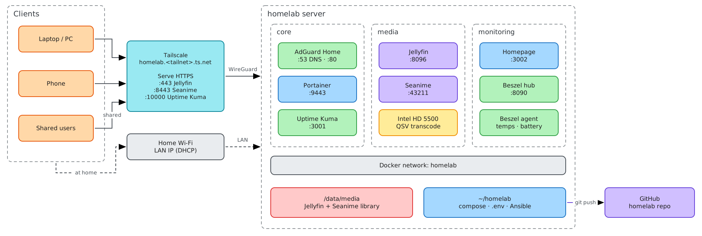
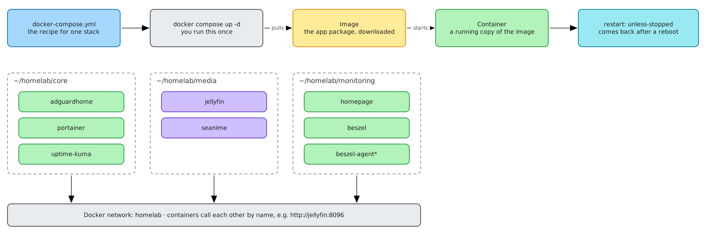
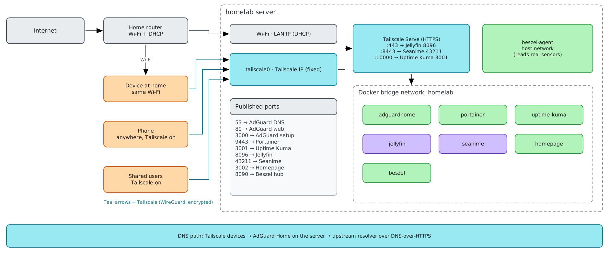

# Homelab

My self hosted homelab on an old laptop running Debian 13, managed with Docker Compose, Tailscale and Ansible.

## Architecture



Everything runs on one old laptop, split into three stacks by purpose. `core` is for network and management, `media` is for watching, and `monitoring` is for keeping an eye on the server. I connect through Tailscale instead of opening router ports, so nothing is exposed to the public internet. The compose files and Ansible playbook live in this repo, so the whole setup can be rebuilt from Git.

## Hardware

| Part | Spec |
|---|---|
| Machine | HP ProBook 450 G2 |
| CPU | Intel Core i7-5500U (2 cores / 4 threads) |
| RAM | 8 GB |
| GPU | Intel HD Graphics 5500 (used for Jellyfin transcoding), AMD Radeon R5 M255 (idle) |
| Storage | 1 TB HDD |
| Network | WiFi |
| OS | Debian 13 (trixie) |

## Stacks

| Stack | Services | Purpose |
|---|---|---|
| `core` | AdGuard Home, Portainer, Uptime Kuma | DNS ad blocking, container management, uptime checks |
| `media` | Jellyfin, Seanime | Media server and anime library |
| `monitoring` | Homepage, Beszel | Dashboard and resource monitoring |

## How it works

* **Docker Compose** gives one folder per stack, all on a shared `homelab` network.
* **Tailscale** gives private access from anywhere with no open router ports. Tailscale Serve provides HTTPS at `homelab.<tailnet>.ts.net`.
* **Ansible** uses `ansible/site.yml` to rebuild the server setup from scratch.
* **Media** lives under one `/data` root, so downloads and the library share a disk.
* **Hardware transcoding** in Jellyfin uses the Intel iGPU (Quick Sync).

## Docker setup



Each folder holds one stack with its own compose file, so I can restart `media` without touching DNS. All containers join a shared `homelab` network, which lets them reach each other by name (for example, Uptime Kuma checks Jellyfin as `jellyfin`) instead of by IP. The `unless-stopped` restart policy brings everything back after a reboot. `beszel-agent` is the exception, since it runs on the host network so it can read the laptop's real CPU temperature sensors.

## Network



There are two ways in, the home WiFi when I'm at home, and Tailscale from anywhere. The server's home IP can change, but its Tailscale address never does, so links keep working even if I switch routers. Tailscale Serve adds real HTTPS for the main apps, and access rules limit what shared users can reach. AdGuard Home handles DNS for Tailscale devices, blocking ads before they load.

## Rebuild

```bash
git clone https://github.com/RividuPesara/homelab.git ~/homelab
cd ~/homelab/ansible
ansible-playbook site.yml --ask-become-pass
```
