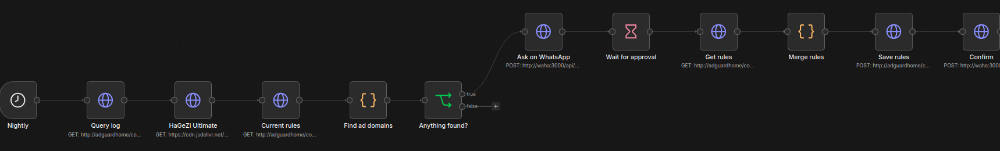
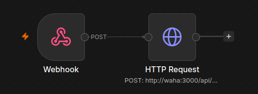

# Homelab

My self hosted homelab on an old laptop running Debian 13, managed with Docker Compose, Tailscale and Ansible.

## Architecture


Everything runs on one old laptop, split into four stacks by purpose. `core` is for network and management, `media` is for watching, `monitoring` is for keeping an eye on the server, and `automation` sends me WhatsApp messages and runs small jobs. A few systemd scripts on the host handle things Docker can't, like shutting down if the laptop overheats. I connect through Tailscale instead of opening router ports, so nothing is exposed to the public internet. The compose files, scripts and Ansible playbook live in this repo, so the whole setup can be rebuilt from Git.

## Hardware

| Part | Spec |
|---|---|
| Machine | HP ProBook 450 G2 |
| CPU | Intel Core i7-5500U (2 cores / 4 threads) |
| RAM | 8 GB |
| GPU | Intel HD Graphics 5500 (used for Jellyfin transcoding), AMD Radeon R5 M255 (idle) |
| Storage | 1 TB HDD |
| Network | WiFi |
| OS | Debian 13 (trixie) |

## Stacks

| Stack | Services | Purpose |
|---|---|---|
| `core` | AdGuard Home, Portainer, Uptime Kuma | DNS ad blocking, container management, uptime checks |
| `media` | Jellyfin, Seanime | Media server and anime library |
| `monitoring` | Homepage, Beszel | Dashboard and resource monitoring |
| `automation` | n8n, WAHA | WhatsApp alerts and automations |

## How it works

* **Docker Compose** gives one folder per stack, all on a shared `homelab` network.
* **Tailscale** gives private access from anywhere with no open router ports. Tailscale Serve provides HTTPS at `homelab.<tailnet>.ts.net`.
* **AdGuard Home** is the DNS server for every Tailscale device and blocks ads with the HaGeZi Multi Pro and Threat Intelligence Feeds lists.
* **n8n + WAHA** run my automations and send messages to my phone through a second WhatsApp number.
* **systemd scripts** on the host send a startup report, shut down on overheating and turn the screen off when idle.
* **Ansible** uses `ansible/site.yml` to rebuild the server setup from scratch.
* **Media** lives under one `/data` root, so downloads and the library share a disk.
* **Hardware transcoding** in Jellyfin uses the Intel iGPU (Quick Sync).

## Docker setup


Each folder holds one stack with its own compose file, so I can restart `media` without touching DNS. All containers join a shared `homelab` network, which lets them reach each other by name (for example, n8n talks to `adguardhome` and `waha`) instead of by IP. The `unless-stopped` restart policy brings everything back after a reboot. `beszel-agent` is the exception, since it runs on the host network so it can read the laptop's real CPU temperature sensors.

## Network


There are two ways in, the home WiFi when I'm at home, and Tailscale from anywhere. The server's home IP can change, but its Tailscale address never does, so links keep working even if I switch routers. Tailscale Serve adds real HTTPS for Jellyfin, Seanime, Uptime Kuma and AdGuard, and access rules limit what shared users can reach. AdGuard Home handles DNS for Tailscale devices, blocking ads before they load. Alerts reach my phone on WhatsApp, either from n8n or straight from Uptime Kuma to WAHA.

## Automations

| Workflow | Trigger | What it does |
|---|---|---|
| Startup report (n8n) | `homelab-report` script at boot | Sends a WhatsApp message with apps up, disk, temperature and IP |
| Downtime alerts (no n8n) | Uptime Kuma webhook straight to WAHA | Sends a WhatsApp message when an app goes down or comes back |
| Ad hunter (n8n) | Every night at 21:00 | Finds new ad and tracker domains in the AdGuard query log, asks me on WhatsApp, and adds them to AdGuard after I approve |

**Ad hunter**



It reads the last 24 hours of the AdGuard query log and checks each domain against the stricter HaGeZi Ultimate list and an ads or tracker name pattern. Domains already in my custom rules, and a few that break apps when blocked, are skipped. I get the list on WhatsApp with an approve link, and the workflow waits up to 24 hours before adding them as AdGuard custom rules.

**Startup report**



A webhook receives the report from the boot script and forwards it to WAHA.

Workflow exports are in `automation/workflows/` and can be imported into n8n with Import from file. Credentials and my phone number are not included.

## Scripts

| Script | What it does |
|---|---|
| `temp-guard` | Checks the CPU temperature every 30 seconds and shuts down cleanly after 3 checks in a row at 90°C or above |
| `homelab-report` | Runs at boot, waits for n8n, checks the apps and sends the startup report |
| `screen-idle` | Turns the laptop backlight off after 1 minute without typing and back on with a key press |

The scripts are in `scripts/` and their systemd units are in `scripts/systemd/`. Ansible installs `screen-idle`. The others can be installed by hand:

```bash
sudo cp scripts/<name> /usr/local/bin/
sudo cp scripts/systemd/<name>.* /etc/systemd/system/
sudo systemctl daemon-reload
sudo systemctl enable --now <name>.service
```

For `temp-guard`, enable `temp-guard.timer` instead of the service.

## Rebuild

```bash
git clone https://github.com/RividuPesara/homelab.git ~/homelab
cd ~/homelab/ansible
ansible-playbook site.yml --ask-become-pass
```
